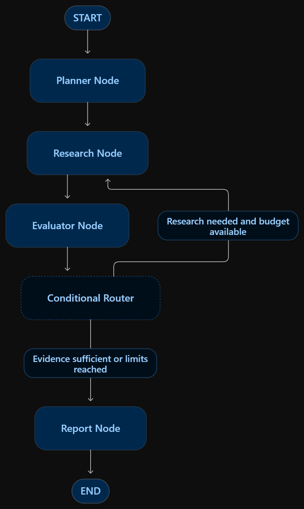

# Deep Research Agent — Technical Design Document

**Version:** 0.1.0  
**Status:** Draft

## 1. Problem Statement

Conducting comprehensive research manually requires significant time and effort to discover relevant sources, evaluate their credibility, identify conflicting information, and synthesize findings.

Conventional LLM-based applications have several limitations:

- Dependence on potentially outdated training data.
- Generation of unsupported or inaccurate claims.
- Insufficient source verification and citation traceability.
- Limited ability to identify and address research gaps.
- Lack of systematic evidence evaluation.

The Deep Research Agent aims to address these limitations by implementing an autonomous, evidence-driven research system capable of planning research tasks, retrieving external information, evaluating collected evidence, conducting iterative research, and generating structured reports with traceable citations.

The system must operate within configurable execution limits and handle failures gracefully.

## 2. Project Objectives

### 2.1 Primary Objective

Design and implement a production-oriented Agentic AI system capable of autonomously conducting multi-step research and generating structured, evidence-backed reports with traceable citations.

### 2.2 Technical Objectives

1. Decompose complex research questions into actionable research tasks.
2. Retrieve relevant information from external sources using web search tools.
3. Collect, organize, and validate research evidence.
4. Evaluate source credibility, relevance, and research coverage.
5. Identify knowledge gaps and dynamically perform additional research.
6. Generate structured reports supported by traceable citations.
7. Maintain shared research state throughout the agent's execution.
8. Enforce configurable limits on execution time, research iterations, and API usage.
9. Handle tool failures, invalid responses, and incomplete research gracefully.
10. Enable independent testing, debugging, and evaluation of individual components.

### 2.3 Engineering Objectives

- Maintain a modular and extensible architecture.
- Minimize coupling between orchestration, LLM providers, and research tools.
- Ensure secure credential management.
- Maintain reproducible development environments.
- Provide execution logs and research traces for debugging.
- Support future API integration, user interfaces, and deployment.

### 2.4 Learning Objectives

- Understand agentic workflows and autonomous decision-making.
- Implement stateful graph-based orchestration.
- Develop reliable LLM and external tool integrations.
- Understand conditional routing and iterative execution.
- Develop systematic debugging and testing skills.
- Evaluate AI-generated research for accuracy, completeness, and citation correctness.

## 3. Project Scope

### 3.1 Minimum Viable Product (MVP)

The initial version will be a terminal-based autonomous research agent that accepts a research question and generates a structured, evidence-backed Markdown report.

The MVP will include:

- Command-line research question input.
- LLM-based research planning and task decomposition.
- External web search and source retrieval.
- Structured evidence collection.
- Source relevance and credibility assessment.
- Research coverage evaluation.
- Dynamic identification of research gaps.
- Conditional and iterative research execution.
- Configurable research iteration, time, and API usage limits.
- Citation-backed Markdown report generation.
- Explicit reporting of insufficient or conflicting evidence.
- Error handling, logging, and execution tracing.
- Unit and integration testing.

### 3.2 Post-MVP Features

The following features will be implemented after the core research agent has been validated:

- FastAPI backend.
- Streamlit web interface.
- Persistent research sessions and execution checkpoints.
- Parallel research task execution.
- Support for multiple LLM and search providers.
- Advanced observability and performance monitoring.
- Research report export in additional formats.
- Docker-based deployment.

### 3.3 Out of Scope

The following features are not required for the initial project:

- Training or fine-tuning custom language models.
- Building a custom web search engine.
- Large-scale web crawling and indexing.
- Multi-agent orchestration without demonstrated necessity.
- Vector databases without a justified retrieval requirement.
- Enterprise authentication and multi-tenant infrastructure.
- Fully autonomous background research without execution limits.

### 3.4 Scope Constraints

- The system will initially use Google Gemini and Tavily.
- Research execution must remain bounded by configurable limits.
- External sources may be incomplete, inaccurate, or inaccessible.
- Generated reports must explicitly acknowledge unresolved research gaps.
- The system must not fabricate sources or citations.
- The system must treat retrieved web content as untrusted data.
- The system must prioritize correctness, maintainability, and testability over feature count.

## 4. Functional Requirements

| ID | Requirement | Expected Behaviour |
|---|---|---|
| FR-01 | User input | Accept and validate a research question. |
| FR-02 | Research planning | Decompose the question into actionable research tasks. |
| FR-03 | Web search | Retrieve relevant information using Tavily. |
| FR-04 | Evidence collection | Store source URLs, titles, extracted content, and unique source identifiers. |
| FR-05 | Evidence evaluation | Assess relevance, credibility, coverage, and conflicting information. |
| FR-06 | Gap identification | Identify unanswered questions and missing evidence. |
| FR-07 | Conditional routing | Decide whether to continue research or generate the final report. |
| FR-08 | Execution limits | Terminate research when configured iteration, time, or API usage limits are reached. |
| FR-09 | Report generation | Generate a structured Markdown report answering the research question. |
| FR-10 | Citation management | Associate factual claims with collected sources and reject unknown citation identifiers. |
| FR-11 | Error handling | Handle API failures, timeouts, empty search results, and invalid LLM responses. |
| FR-12 | Execution logging | Record node execution, research iterations, tool calls, errors, and termination reasons. |
| FR-13 | Report persistence | Save the generated report locally as a Markdown file. |

### 4.1 Execution Rules

- Research must terminate within configured execution limits.
- Additional research must address identified evidence gaps.
- Duplicate sources must be identified and handled.
- Retrieved web content must be treated as untrusted data.
- Reports must disclose insufficient or conflicting evidence.
- Citations must reference collected sources.
- API credentials must never appear in reports or logs.

### 4.2 Delivery Constraints

The project has a 10-day development deadline.

The core research workflow, citation management, reliability, testing, and documentation take priority over additional integrations.

Streamlit will be implemented after the core workflow is validated. FastAPI, Docker, and other advanced features will be deferred if necessary.

## 5. Non-Functional Requirements

| ID | Category | Requirement |
|---|---|---|
| NFR-01 | Performance | Complete research within a configurable execution deadline. |
| NFR-02 | Reliability | Handle external API failures without uncontrolled termination. |
| NFR-03 | Security | Store API credentials in environment variables and exclude secrets from version control and logs. |
| NFR-04 | Maintainability | Use modular components with clearly defined responsibilities. |
| NFR-05 | Testability | Allow individual components to be tested independently using mocked external services. |
| NFR-06 | Observability | Provide structured execution logs for debugging and performance analysis. |
| NFR-07 | Reproducibility | Maintain a consistent Python environment using uv and dependency locking. |
| NFR-08 | Cost efficiency | Limit external API calls and unnecessary research iterations. |
| NFR-09 | Data integrity | Validate structured LLM responses and maintain consistent research state. |
| NFR-10 | Research integrity | Disclose uncertainty, conflicting evidence, and unsupported conclusions. |

### 5.1 Default Execution Limits

| Parameter | Default Value |
|---|---|
| Maximum research iterations | 3 |
| Maximum initial research tasks | 5 |
| Maximum total search calls | 15 |
| Maximum results per search | 5 |
| Maximum total LLM calls | 20 |
| Maximum execution time | 300 seconds |
| External API request timeout | 30 seconds |
| Maximum retries per failed request | 

## 6. System Architecture

### 6.1 Architectural Overview

The system will use a modular, single-agent, stateful graph architecture. LangGraph will manage workflow orchestration, state transitions, conditional routing, and iterative research execution.

Google Gemini will provide reasoning and text generation capabilities, while Tavily will provide external web search and information retrieval.

The research workflow will remain independent of the user interface.

### 6.2 Core Components

| Component | Responsibility |
|---|---|
| User Interface | Accept research questions and display generated reports. |
| Research Planner | Decompose research questions into actionable research tasks. |
| Research Executor | Execute search queries, retrieve information, and collect evidence. |
| Evidence Evaluator | Assess evidence quality, identify research gaps, and recommend further research. |
| Conditional Router | Determine the next execution step based on evaluation results and execution limits. |
| Report Generator | Synthesize collected evidence into a structured research report. |
| Citation Validator | Validate citation identifiers against collected sources. |
| State Manager | Maintain shared research data throughout graph execution. |
| Configuration Manager | Manage environment variables and configurable execution limits. |
| Logging System | Record execution events, errors, API usage, and termination reasons. |

### 6.3 LangGraph Workflow

The initial graph will contain four primary execution nodes:

1. Planner Node
2. Research Node
3. Evaluator Node
4. Report Node

The workflow begins with the Planner Node, followed by the Research Node and Evaluator Node.

After evaluation, a conditional routing function determines whether additional research is necessary and permitted.

If evidence is insufficient and execution limits have not been reached, the workflow returns to the Research Node with updated research tasks.

Otherwise, execution proceeds to the Report Node, where the final report is generated and citations are validated.

The graph then terminates.

### 6.4 Architectural Principles

- Use a single stateful graph for the initial implementation.
- Separate orchestration logic from external service integrations.
- Maintain shared research state as the authoritative execution context.
- Use structured LLM outputs wherever programmatic decisions are required.
- Enforce execution limits using deterministic application logic.
- Keep individual components independently testable.
- Avoid unnecessary abstractions and infrastructure.
- Introduce additional complexity only when justified by measurable requirements.

### 6.5 Data Flow

1. The user submits a research question.
2. The planner generates research tasks.
3. The research executor performs searches and collects evidence.
4. The collected evidence is added to the shared research state.
5. The evaluator assesses evidence and identifies remaining research gaps.
6. The router determines whether research should continue.
7. The report generator synthesizes available evidence.
8. Citation identifiers are validated against collected sources.
9. The final report is saved locally and returned to the user.

### 6.6 External Dependencies

| Dependency | Purpose |
|---|---|
| LangGraph | Stateful workflow orchestration and conditional routing |
| Google Gemini | Planning, reasoning, evaluation, and report generation |
| Tavily | Web search and information retrieval |
| Pydantic | Structured output and data validation |
| python-dotenv | Environment variable loading |
| pytest | Automated testing |
| uv | Dependency and Python environment management |

### 6.7 Architecture Constraints

The initial implementation will use sequential execution, in-memory research state, and local Markdown report storage.

Persistent databases, distributed execution, multi-agent coordination, and parallel research execution are deferred beyond the MVP.

The system must remain functional without a graphical user interface.

## 7. Research State Design

### 7.1 Overview

The research agent will maintain a shared state throughout graph execution.

The graph state will be defined using Python TypedDict, while Pydantic models will be used to represent and validate structured research tasks, evidence, and LLM outputs.

Each graph node will read the current state and return updates to the relevant fields.

### 7.2 State Schema

| Field | Data Type | Purpose |
|---|---|---|
| question | str | Original user research question |
| research_tasks | list[ResearchTask] | Planned and dynamically generated research tasks |
| evidence | list[Evidence] | Collected and deduplicated research evidence |
| evaluation | EvaluationResult or None | Latest evidence assessment |
| iteration_count | int | Number of completed research iterations |
| search_call_count | int | Number of attempted search API calls |
| llm_call_count | int | Number of attempted LLM API calls |
| start_time | float | Monotonic execution start time |
| errors | list[str] | Sanitized execution errors |
| termination_reason | str or None | Reason for ending research |
| final_report | str | Generated Markdown report |
| report_path | str or None | Location of the saved report |

### 7.3 Research Task Model

Each research task will contain:

- task_id: Unique task identifier.
- query: Search query to execute.
- objective: Information the task aims to discover.
- status: Pending, completed, or failed.

### 7.4 Evidence Model

Each evidence record will contain:

- source_id: Unique citation identifier.
- title: Source title.
- url: Original source URL.
- content: Retrieved source content or excerpt.
- search_query: Query used to discover the source.
- relevance_score: Optional relevance assessment.

### 7.5 Evaluation Result Model

The evaluation result will contain:

- is_sufficient: Whether the collected evidence adequately addresses the research question.
- coverage_score: Estimated research coverage between 0 and 1.
- missing_information: Identified research gaps.
- conflicting_information: Identified inconsistencies between sources.
- suggested_queries: Additional search queries.
- reasoning: Brief justification for the evaluation decision.

### 7.6 State Management Rules

- The original research question must remain unchanged.
- Evidence must accumulate across research iterations.
- Duplicate source URLs must be handled before adding evidence.
- Source identifiers must remain stable throughout execution.
- Execution counters must be updated by application logic.
- Nodes must return explicit state updates instead of directly mutating shared state.
- Structured LLM outputs must be validated before entering the state.
- API credentials must never be stored in the research state.
- Execution limits must be enforced independently of LLM decisions.

### 7.7 Node Responsibilities

| Node | Reads | Updates |
|---|---|---|
| Planner | Question | Research tasks, LLM counter |
| Researcher | Tasks, evidence, execution counters | Task status, evidence, search counter, iteration counter |
| Evaluator | Question, tasks, evidence | Evaluation result, additional tasks, LLM counter |
| Reporter | Question, evidence, evaluation, termination reason | Final report, report path, LLM counter |

Execution counters and errors may also be updated by supporting application functions.

### 7.8 State Persistence

The MVP will maintain research state in memory during each execution.

Persistent checkpoints, session recovery, and database-backed state management are deferred beyond the initial implementation.

## 8. Project Directory Structure

### 8.1 Directory Organization

The project will use a modular Python package structure that separates workflow orchestration, business logic, external integrations, and automated testing.

### 8.2 File Responsibilities

| File or Directory | Responsibility |
|---|---|
| research_agent/ | Core research agent package |
| config.py | Environment variables, application settings, and execution limits |
| models.py | Pydantic models and structured data validation |
| state.py | LangGraph shared state definition |
| graph.py | Graph construction, conditional routing, and workflow orchestration |
| nodes/planner.py | Research planning and task decomposition |
| nodes/researcher.py | Search execution and evidence collection |
| nodes/evaluator.py | Evidence assessment and research gap identification |
| nodes/reporter.py | Report generation and local report persistence |
| tools/search.py | Tavily search integration |
| tools/llm.py | Google Gemini integration |
| utils/citations.py | Citation mapping and validation |
| utils/logger.py | Application logging configuration |
| tests/ | Automated unit and integration tests |
| reports/ | Generated Markdown research reports |
| docs/ | Technical design documentation |
| main.py | Command-line application entry point |
| app.py | Streamlit interface after core workflow validation |
| .env | Private environment configuration |
| .env.example | Public environment configuration template |
| pyproject.toml | Project metadata and dependency declarations |
| uv.lock | Locked dependency versions |
| README.md | Project overview, setup instructions, and usage examples |

### 8.3 Code Organization Rules

- Each module must have a clearly defined responsibility.
- Graph nodes must not directly manage external service configuration.
- External API integrations must be independently testable.
- User interface code must remain separate from the core research workflow.
- Configuration values must not be unnecessarily duplicated across modules.
- Generated reports must remain separate from application source code.
- API credentials must never be committed to version control.
- Dependencies must be managed using uv.
- Files and abstractions must be introduced incrementally as required.

### 8.4 Dependency Flow

The application entry point invokes the graph orchestration layer.

The graph orchestration layer coordinates research nodes.

Research nodes use external service integrations, shared data models, and supporting utilities.

External service integrations must not depend on graph nodes or user interface components.

Circular dependencies must be avoided.

### 8.5 Implementation Strategy

The directory structure represents the intended architecture rather than a requirement to create every file immediately.

Modules will be introduced incrementally, implemented, and tested as development progresses.

.png>)

## 9. Testing and Evaluation Strategy

### 9.1 Testing Objectives

The testing strategy will verify functional correctness, execution reliability, research quality, citation integrity, and compliance with configured execution limits.

Automated tests will be implemented using pytest.

### 9.2 Testing Levels

| Testing Level | Purpose |
|---|---|
| Unit testing | Verify individual functions, models, and components. |
| Integration testing | Verify interactions between graph nodes and external service integrations. |
| End-to-end testing | Verify the complete research workflow from user input to final report. |
| Research evaluation | Assess the quality and reliability of generated research reports. |

### 9.3 Core Test Cases

| ID | Test Case | Expected Result |
|---|---|---|
| TC-01 | Empty research question | Input is rejected. |
| TC-02 | Valid research question | Structured research tasks are generated. |
| TC-03 | Invalid LLM response | Validation failure is handled gracefully. |
| TC-04 | Successful web search | Evidence is collected and stored. |
| TC-05 | Duplicate source URL | Duplicate evidence is prevented. |
| TC-06 | Empty search results | Execution continues safely or terminates with insufficient evidence. |
| TC-07 | Insufficient evidence | Additional research is triggered when budget permits. |
| TC-08 | Sufficient evidence | Execution proceeds to report generation. |
| TC-09 | Maximum iterations reached | Research loop terminates. |
| TC-10 | API call budget exhausted | Additional calls are prevented. |
| TC-11 | API timeout or failure | Configured failure-handling logic is executed. |
| TC-12 | Unknown citation identifier | Invalid citation is detected. |
| TC-13 | Successful report generation | Markdown report is saved locally. |
| TC-14 | Execution deadline reached | Further research stops and a partial report is produced when possible. |
| TC-15 | Malicious instructions in retrieved content | Retrieved instructions do not override application execution rules. |

### 9.4 Research Quality Metrics

| Metric | Description |
|---|---|
| Relevance | Whether the report addresses the original research question. |
| Completeness | Whether the report covers the major aspects of the question. |
| Factual accuracy | Whether factual claims are supported by reliable evidence. |
| Citation validity | Whether citation identifiers resolve to collected sources. |
| Citation correctness | Whether cited sources actually support their associated claims. |
| Source diversity | Whether the report incorporates independent and relevant sources. |
| Research efficiency | Whether useful evidence is obtained within execution limits. |
| Uncertainty handling | Whether incomplete

## 10. Development Roadmap and Acceptance Criteria

### 10.1 Development Roadmap

| Day | Milestone | Deliverable |
|---|---|---|
| 1 | Design and foundation | Technical documentation, environment configuration, project structure, and API connectivity |
| 2 | Core agent foundation | Pydantic models, shared research state, planner node, and initial LangGraph workflow |
| 3 | Research integration | Tavily integration, evidence collection, source identification, and deduplication |
| 4 | Autonomous research | Evidence evaluator, research gap identification, conditional routing, and iterative execution |
| 5 | Report generation | Structured Markdown reports, citation validation, and local report storage |
| 6 | Reliability | Execution limits, retries, timeouts, error handling, and structured logging |
| 7 | Testing and evaluation | Automated tests, evaluation dataset, and baseline comparison |
| 8 | Application interface | Streamlit interface, research input, and report visualization |
| 9 | Documentation and packaging | README, architecture diagrams, example reports, and optional Docker configuration |
| 10 | Final validation | End-to-end testing, bug fixes, evaluation results, and project demonstration |

### 10.2 Implementation Priorities

#### P0 — Mandatory

- Research planning and task decomposition.
- External web search and evidence collection.
- Stateful LangGraph orchestration.
- Evidence evaluation and conditional research loops.
- Execution limits and termination conditions.
- Citation-backed report generation.
- Error handling and logging.
- Automated testing and research evaluation.
- Project documentation.

#### P1 — High Priority

- Streamlit interface.
- Baseline performance comparison.
- Example research reports.
- Improved report formatting and usability.

#### P2 — Optional

- Docker configuration.
- Advanced observability.
- Additional report export formats.

#### Deferred

- FastAPI backend.
- Multi-agent orchestration.
- Persistent research sessions.
- Parallel research execution.
- Vector database integration.

### 10.3 Definition of Done

A development component is considered complete when:

- Its functional requirements are implemented.
- Its expected behaviour has been verified.
- Relevant failure scenarios are handled.
- Necessary automated tests are implemented and passing.
- No sensitive credentials are exposed.
- The implementation is understandable and maintainable.
- Relevant documentation is updated.

### 10.4 Project Acceptance Criteria

The MVP will be considered complete when:

- A user can submit a research question through the command-line interface.
- The agent autonomously generates and executes a research plan.
- Evidence is collected from external sources.
- Additional research is performed when evidence is insufficient and execution budget remains.
- Research terminates within configured execution limits.
- A structured Markdown report is generated and saved.
- All citation identifiers resolve to collected sources.
- Incomplete or conflicting evidence is explicitly disclosed.
- Critical automated tests pass.
- Research quality and operational metrics are documented.
- The project can be reproduced using the documented setup instructions.

### 10.5 Risk Management

| Risk | Mitigation |
|---|---|
| API rate limits | Bounded calls, controlled retries, and mocked tests |
| Invalid LLM outputs | Structured output validation and failure handling |
| Infinite research loops | Deterministic termination conditions |
| Fabricated citations | Stable source identifiers and programmatic validation |
| Prompt injection | Treat external content as untrusted data and enforce application-level constraints |
| Development delays | Prioritize mandatory features and defer optional integrations |
| Poor research quality | Evaluate reports against a consistent rubric |
| Dependency conflicts | Use uv and maintain a locked dependency environment |

### 10.6 Final Deliverables

- Functional research agent source code.
- Technical design document.
- Project README with setup and usage instructions.
- Automated test suite.
- Research evaluation dataset.
- Documented evaluation results.
- Example citation-backed research reports.
- Reproducible dependency configuration.
- Streamlit interface, subject to core workflow completion.

### 10.7 Development Principles

- Build incrementally.
- Test before introducing additional complexity.
- Investigate root causes instead of applying unexplained fixes.
- Prefer simple, maintainable implementations.
- Avoid premature optimization.
- Never fabricate evaluation results.
- Prioritize a reliable working system over feature count.

This document serves as the initial technical specification. Architectural changes discovered during implementation must be reflected in the documentation.

## 11. Architecture Decision Record

### ADR-001: Change Primary LLM Provider

**Date:** 2026-11-25

**Status:** Accepted

#### Context

Google Gemini was originally selected as the primary
LLM provider. However, live generation tests failed
across multiple models with HTTP 404, 503, and 504
errors.

Direct Google SDK testing also returned HTTP 503,
indicating that the failure was not specific to the
LangChain integration.

#### Decision

Use Groq as the primary LLM provider.

- Provider: Groq
- Model: openai/gpt-oss-20b
- Integration: langchain-groq
- Temperature: 0
- Request timeout: 30 seconds
- Environment variable: GROQ_API_KEY

#### Rationale

- Successful live text generation test.
- Compatibility with the LangChain ecosystem.
- Minimal impact on the existing architecture.
- Avoid further delays caused by Gemini availability.

#### Consequences

- The core LangGraph workflow remains unchanged.
- LLM configuration will be centralized.
- Gemini remains a potential future alternative.
- Automatic provider fallback is deferred.
- Structured output compatibility, research quality,
  and performance require further evaluation.

#### Verification

- Groq API authentication: Passed
- Groq text generation: Passed
- Tavily search execution: Passed
- Gemini text generation: Deferred